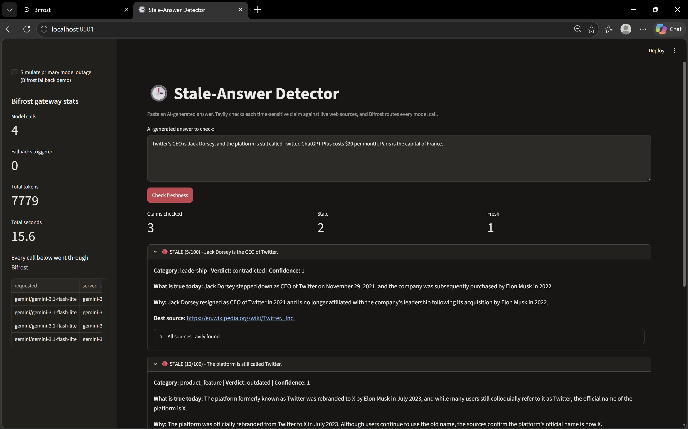
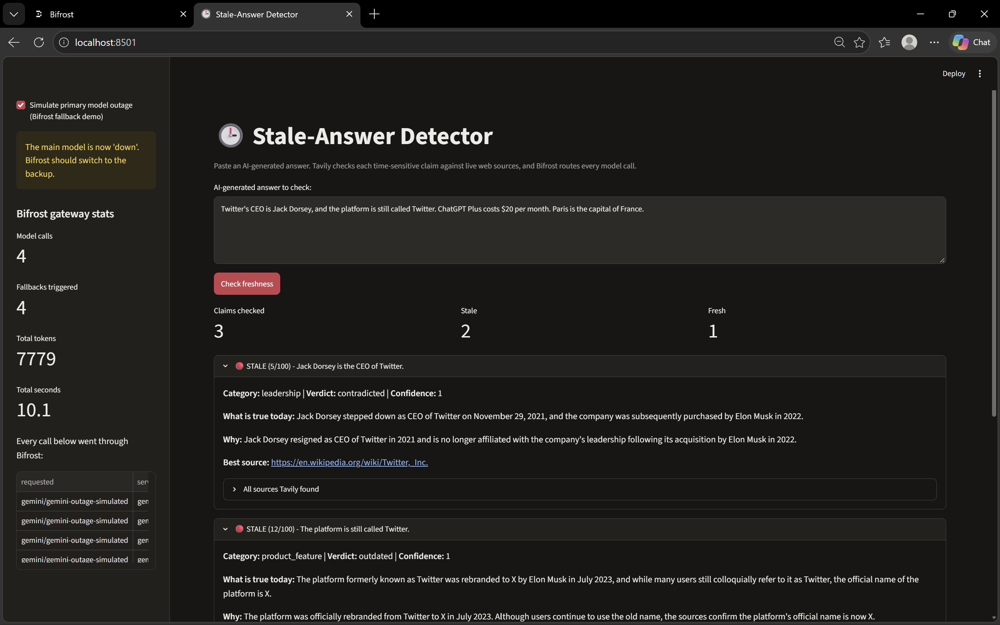
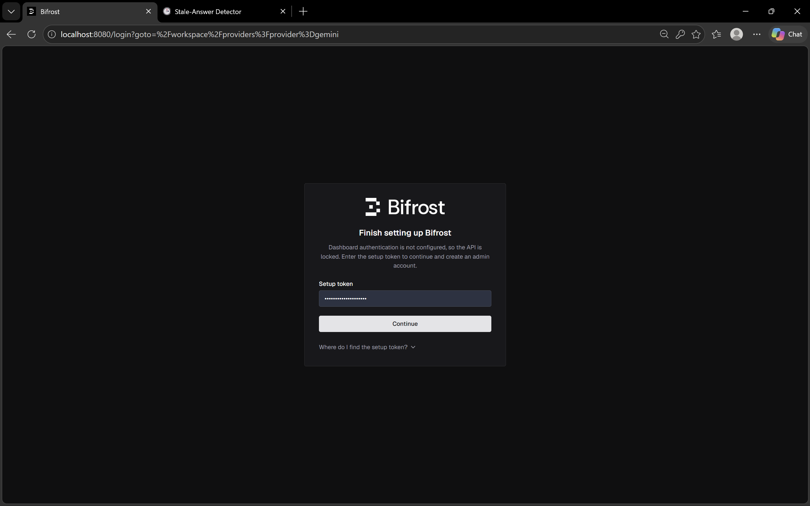
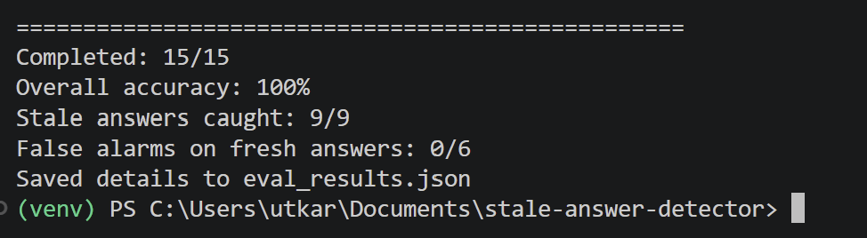

# 🕒 Stale-Answer Detector

**A verification layer that catches outdated facts in AI-generated answers.**

Large language models confidently state facts that have since changed: a CEO who resigned, a product that was renamed, a price that went up. This project takes an LLM-generated answer, finds the claims that could have gone stale, re-checks them against live web sources, and gives each claim a transparent **freshness score**.

Built for the Geek Room Global AI Hackathon, Problem Statement 06 (Tavily), using both **Tavily** and **Bifrost by Maxim AI**.

## What it does

1. **Claim identification:** finds factual statements in an answer that may be time-sensitive.
2. **Freshness detection:** rates each claim's volatility (pricing, API versions, laws, leadership, and so on) and skips stable facts such as geography.
3. **Live verification:** searches the live web for each flagged claim and compares the claim to the evidence.
4. **Freshness scoring:** gives each claim a 0 to 100 score, a verdict, a short reason, and a source link.

Example: *"Twitter's CEO is Jack Dorsey"* is flagged **STALE (5/100)**, with a link to the source showing he resigned in 2021.
## Screenshots

**Results with live sources and freshness scores**



**Bifrost automatic fallback (simulated outage)**



**Bifrost request logs**



**Evaluation results**



## How the two technologies are used

| Technology | Role in this project |
|---|---|
| **Tavily** | Supplies the live web evidence. Every flagged claim is searched with Tavily, which returns current sources, URLs, and page content that the verifier reads. Without it, the system could only guess from the model's own memory. |
| **Bifrost** | Handles every model request through one OpenAI-compatible gateway. It runs claim extraction and verification, provides automatic fallback to a backup model when the primary fails, and reports per-call stats (model, tokens, latency) shown in the app. |

### Bifrost fallback demo
The app has an **"Simulate primary model outage"** switch. When enabled, requests are sent to a model that does not exist, with a real model listed as a fallback. Bifrost detects the failure, switches to the backup on its own, and the app still returns correct results. The sidebar shows how many fallbacks were triggered.

## Architecture

```
AI-generated answer
        |
        v
[Bifrost] claim extraction + volatility rating
        |
        v
time-sensitive claims -----> (stable facts are skipped)
        |
        v
[Tavily] live web search, one query per claim
        |
        v
[Bifrost] verification: claim vs. sources -> verdict + confidence
        |
        v
Rule-based freshness scorer (0-100)
        |
        v
Streamlit UI: scores, reasons, sources, Bifrost stats
```

## Freshness score

The score is rule-based, so every number can be explained:

| Verdict | Base score |
|---|---|
| supported | 70 to 100, rising with confidence |
| inconclusive | 50 |
| outdated or contradicted | 5 to 30, falling with confidence |

Adjustments: official or primary sources (for example `.gov`, documentation, help centers, Wikipedia) raise confidence slightly, and social media sources lower it. Scores are capped between 5 and 95, because web evidence is never perfect. Labels: **FRESH** (70 or more), **UNCERTAIN** (40 to 69), **STALE** (under 40).

## Evaluation

I built a 15-case test set (`tests.json`) with 9 stale answers and 6 still-correct answers, covering leadership changes, product renames, software versions, pricing, and "latest" claims. Run it with `python eval.py`.

| Run | Accuracy | Stale answers caught | False alarms |
|---|---|---|---|
| First run | 93% (14/15) | 8/9 | 0/6 |
| After tuning | 100% (15/15) | 9/9 | 0/6 |

The failure in the first run was a claim containing the words "most recent", which the extractor had rated as a stable fact. The fix was to teach the extractor to treat time-relative words as high volatility, and to add recency to the search query so newer pages rank higher.

**Caveat:** the tuning was done after seeing that failure, so 100% is a result on a development set and not a formal benchmark. The answer key was written and checked by hand, and some facts may change over time.

## Installation

### Requirements
- Python 3.10 or newer
- Node.js (LTS), used to run Bifrost
- A **Tavily API key** (tavily.com)
- A **Gemini API key** (aistudio.google.com, free tier works)

### 1. Get the code
```
git clone https://github.com/Utkarshgautam9812/stale-answer-detector.git
cd stale-answer-detector
```

### 2. Set up Python (Windows PowerShell)
```
python -m venv venv
venv\Scripts\Activate.ps1
pip install -r requirements.txt
```
On Mac or Linux, activate with `source venv/bin/activate` instead.

### 3. Add your settings
Copy `.env.example` to `.env` and put in your Tavily key:
```
copy .env.example .env
```
```
TAVILY_API_KEY=your-tavily-key-here
BIFROST_URL=http://localhost:8080/v1
EXTRACT_MODEL=gemini/gemini-3.1-flash-lite
VERIFY_MODEL=gemini/gemini-3.1-flash-lite
FALLBACK_MODELS=
```

### 4. Run Bifrost (in a second terminal)
```
mkdir bifrost-data
cd bifrost-data
$env:BIFROST_SETUP_TOKEN="choose-any-token"
npx -y @maximhq/bifrost
```
Then open http://localhost:8080 and:
1. Enter your setup token to finish first-time setup.
2. Go to **Models → Model Providers**, add **Gemini**, and paste your Gemini key.
3. In **Security Settings**, make sure **Enforce Virtual Keys on Inference** is turned off.

### 5. Run the app
In the first terminal, with the virtual environment active:
```
streamlit run app.py
```
Open http://localhost:8501, paste an AI-generated answer, and click **Check freshness**.

### 6. Run the evaluation (optional)
```
python eval.py
```

## Project structure

| File | Purpose |
|---|---|
| `app.py` | Streamlit interface, including the Bifrost stats panel and outage switch |
| `llm.py` | All model calls, sent through Bifrost, with usage tracking and the fallback switch |
| `claims.py` | Claim extraction and volatility rating |
| `verify.py` | Tavily search and claim verification |
| `scoring.py` | Transparent freshness scoring |
| `pipeline.py` | Connects extract, search, verify, and score |
| `eval.py`, `tests.json` | Evaluation set and runner |
| `test_*.py`, `debug_one.py` | Small development helpers |

## Technologies used
- **Tavily**: live web search and source retrieval
- **Bifrost by Maxim AI**: LLM gateway (unified API, automatic fallbacks, usage metrics)
- **Gemini** (via Bifrost): claim extraction and verification
- **Python**, **Streamlit**, the **OpenAI Python SDK** (pointed at Bifrost)

## Limitations and future work
- Verdict quality depends on what Tavily returns. If it returns only old pages, the system can mark a claim as outdated by date reasoning and lowers its confidence.
- Source authority uses simple URL rules, not a full reputation model.
- Claims that need numeric or multi-step reasoning can be marked inconclusive.
- The test set is small (15 cases) and hand-labeled.
- Free-tier rate limits make large batches slow.
- Future work: a larger blind test set, per-claim date extraction from page metadata, a browser extension that checks chatbot answers as they are written, and multi-model cross-checking through Bifrost.

## Author
Utkarsh Gautam